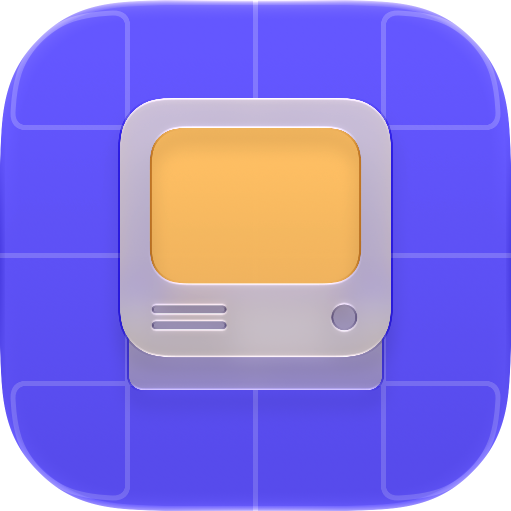

<picture><source media="(prefers-color-scheme: dark)" srcset="assets/mark-dark.png"></picture>

<h1 align="center">Wherever you chat, your computer is there.</h1>

ChatGPT and other MCP clients can read and write code, run commands and use your tools on your Mac, with permissions you set on each computer.

<a href="https://github.com/computer-mcp/computer-mcp/tree/master/Documentation">Documentation</a> · <a href="https://github.com/computer-mcp/.github/blob/master/CONTRIBUTING.md">Contributing</a> · <a href="https://github.com/computer-mcp/.github/blob/master/SECURITY.md">Security</a> · <a href="https://github.com/computer-mcp/.github/blob/master/SUPPORT.md">Support</a>

<h2>Use Computer MCP</h2>

<table>
<tr><td><picture><source media="(prefers-color-scheme: dark)" srcset="https://raw.githubusercontent.com/computer-mcp/computer-mcp/HEAD/.github/assets/logo/logo-dark.png"></picture></td><td><strong><a href="https://github.com/computer-mcp/computer-mcp">computer-mcp</a></strong> Connect ChatGPT and other MCP clients to your Mac&#x27;s tools, with permissions set on each computer.</td></tr>
<tr><td><picture><source media="(prefers-color-scheme: dark)" srcset="https://raw.githubusercontent.com/computer-mcp/computer-mcp/HEAD/.github/assets/logo/logo-dark.png"></picture></td><td><strong><a href="https://github.com/computer-mcp/homebrew-tap">homebrew-tap</a></strong> Install the Computer MCP App and Apple CLI with Homebrew.</td></tr>
<tr><td><picture><source media="(prefers-color-scheme: dark)" srcset="https://raw.githubusercontent.com/computer-mcp/computer-mcp/HEAD/.github/assets/logo/logo-dark.png"></picture></td><td><strong><a href="https://github.com/computer-mcp/computer-mcp.github.io">computer-mcp.github.io</a></strong> Read the product guide, get verified downloads and browse the plugin catalog.</td></tr>
</table>

<h2>Hand work to coding agents</h2>

<table>
<tr><td><picture><source media="(prefers-color-scheme: dark)" srcset="https://raw.githubusercontent.com/computer-mcp/plugin-claude/HEAD/.github/assets/logo/logo-dark.png"></picture></td><td><strong><a href="https://github.com/computer-mcp/plugin-claude">plugin-claude</a></strong> Run Claude Code from your chat and stream its results back.</td></tr>
<tr><td><picture><source media="(prefers-color-scheme: dark)" srcset="https://raw.githubusercontent.com/computer-mcp/plugin-codex/HEAD/.github/assets/logo/logo-dark.png"></picture></td><td><strong><a href="https://github.com/computer-mcp/plugin-codex">plugin-codex</a></strong> Run Codex from your chat and inspect its protocol traffic.</td></tr>
<tr><td><picture><source media="(prefers-color-scheme: dark)" srcset="https://raw.githubusercontent.com/computer-mcp/plugin-cursor/HEAD/.github/assets/logo/logo-dark.png"></picture></td><td><strong><a href="https://github.com/computer-mcp/plugin-cursor">plugin-cursor</a></strong> Run Cursor&#x27;s agent from your chat over ACP.</td></tr>
</table>

<h2>Add tools for your Mac</h2>

<table>
<tr><td><picture><source media="(prefers-color-scheme: dark)" srcset="https://raw.githubusercontent.com/computer-mcp/plugin-computer-use/HEAD/.github/assets/logo/logo-dark.png"></picture></td><td><strong><a href="https://github.com/computer-mcp/plugin-computer-use">plugin-computer-use</a></strong> Let your chat see and act on the apps on your Mac.</td></tr>
<tr><td><picture><source media="(prefers-color-scheme: dark)" srcset="https://raw.githubusercontent.com/computer-mcp/plugin-swift-format/HEAD/.github/assets/logo/logo-dark.png"></picture></td><td><strong><a href="https://github.com/computer-mcp/plugin-swift-format">plugin-swift-format</a></strong> Format and lint Swift code with a verified swift-format.</td></tr>
<tr><td><picture><source media="(prefers-color-scheme: dark)" srcset="https://raw.githubusercontent.com/computer-mcp/apple-cli/HEAD/.github/assets/logo/logo-dark.png"></picture></td><td><strong><a href="https://github.com/computer-mcp/apple-cli">apple-cli</a></strong> Use Notes, Reminders, Calendar and other Apple apps from the terminal or an MCP client.</td></tr>
</table>

<h2>Maintain the family</h2>

<table>
<tr><td><picture><source media="(prefers-color-scheme: dark)" srcset="https://raw.githubusercontent.com/computer-mcp/github-workflows/HEAD/.github/assets/logo/logo-dark.png"></picture></td><td><strong><a href="https://github.com/computer-mcp/github-workflows">github-workflows</a></strong> Shared CI, source policy and release workflows for the family&#x27;s repositories.</td></tr>
</table>
